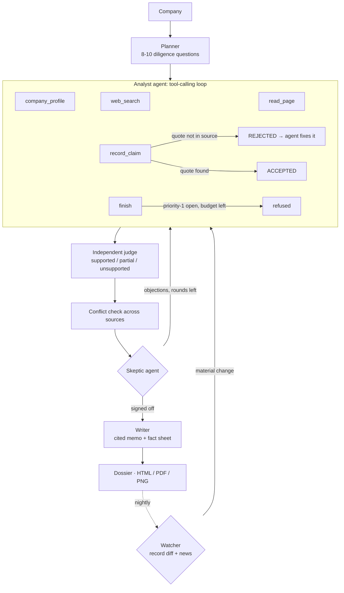
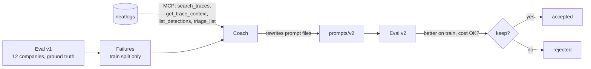

# Underwrite

**A team of AI agents that does venture due diligence while you sleep, and checks its own work.**
Give it a list of startups. An **analyst agent** decides what to look up, reads sources and records every fact with
the exact sentence it came from; facts that don't match their source are bounced back to it on the spot. A **skeptic
agent** attacks the result and sends the analyst back until the evidence holds up. A **watcher** re-checks every
company each night and re-investigates only what changed. A **coach agent** reads all of this from
[neatlogs](https://neatlogs.com) traces, rewrites the agents' prompts, and keeps a change only if the eval score goes up.

**Live site (memo gallery + scoreboard):** https://hacker-git-code.github.io/underwrite-/
&nbsp;·&nbsp; Built for **#neatHack** (Oct 10–12, 2026), theme: *"Build agents you'd trust to run without you watching."*

<p align="center"></p>

Each memo is a three-page dossier modelled on Sequoia's famous 1977 evaluation form for Apple:
**page 1** an evaluation form (typed labels, hand-written answers, red circled source numbers, a VERIFIED stamp,
conflicts noted in the margin), **page 2** a typed memorandum with the full analysis, **page 3** an appendix with every
source, the claims it supports, the claims that were rejected, and the agent's run log. Download as PDF, or page 1 as PNG.

---

## Contents

- [What it does](#what-it-does)
- [Why you can trust it unattended](#why-you-can-trust-it-unattended)
- [How it works](#how-it-works)
- [Self-improvement: the Coach and neatlogs](#self-improvement-the-coach-and-neatlogs)
- [Results](#results)
- [Sponsor tools and how each is used](#sponsor-tools-and-how-each-is-used)
- [Quickstart](#quickstart)
- [Commands](#commands)
- [Configuration](#configuration)
- [Running it unattended on AWS](#running-it-unattended-on-aws)
- [Project layout](#project-layout)
- [Evidence checklist for judges](#evidence-checklist-for-judges)
- [Security and privacy](#security-and-privacy)
- [Limitations and roadmap](#limitations-and-roadmap)

## What it does

A real run (Ramp, agent mode), shortened:

```
$ underwrite run "Ramp" --domain ramp.com

[recover ] gemini-3.8-flash failed (daily quota exhausted); falling back to gemini-3.5-flash
[recover ] gemini-3.5-flash failed (daily quota exhausted); falling back to groq:openai/gpt-oss-120b
[plan    ] 10 questions, 20 queries for Ramp
[agent   ] step 1  -> company_profile()
[agent   ] step 2  -> record_claim(field='founded_year', value='2019', evidence_id='E1')     → ACCEPTED C1
[agent   ] step 4  -> web_search('Ramp founders CEO Eric Glyman Karim Atiyeh')
[agent   ] step 5  -> record_claim(field='ceo', 'Eric Glyman and Karim Atiyeh serve as Co-CEOs', evidence_id='E7')
...
[agent   ] round 1 ended on budget after 24 steps
[verify  ] judge: 11 supported, 0 partial, 0 rejected of 11
[skeptic ] objection: key traction numbers rely on a single low-authority source
[skeptic ] objection: no evidence on risks or controversies - a priority-1 question
[skeptic ] sending the analyst back for round 2
[agent   ] step 25 -> web_search('Ramp customer count revenue 70,000 Bloomberg TechCrunch')
[agent   ] step 27 -> web_search('Ramp lawsuits controversy security incident regulatory issues')
[extract ] C13 In May 2025, a Congressman investigated Ramp over its attempt to win a $25 million federal contract
[verify  ] claim rejected in-loop: quote not in E20 (match 53%) — agent must fix it
[verify  ] self-corrected: C14 accepted after the agent fixed a rejected claim
[agent   ] step 40 -> finish(...)
[memo    ] done in 212s · 15 claims · 93% supported · 11 Crustdata credits · 2 recoveries
```

Nobody told it to look for a congressional investigation: the skeptic objected that risks were unexamined, and the
analyst went and found one. It also found that Ramp's CEO had just made his co-founder co-CEO, with the source linked.

A first-pass diligence memo takes an analyst hours. Underwrite produces one in 3–5 minutes for about 11–19 Crustdata
credits, and the LLM side runs on free tiers.

### Three agents, one loop

| Agent | Decides | Guardrails around it |
|---|---|---|
| **Analyst** (tool-calling loop) | which tool to call next: `company_profile`, `web_search`, `read_page`, `record_claim`, `update_question`, `add_question`, `finish` | every claim is grounded against its cited source **the moment it is recorded** and bounced back if the quote isn't there; budgets shown after every action; `finish` refused while priority-1 questions are open; old page text compacted out of context; conversation checkpointed every step |
| **Skeptic** | whether the evidence is good enough, or which 1–4 objections must be fixed first | sees only what an investment committee would see; can send the analyst back while rounds and budget remain |
| **Watcher** (nightly) | whether a company changed since its memo (fresh Crustdata record diff + news since the memo) | re-investigation is scoped to one new priority-1 question, seeded with the previous verified claims |
| **Coach** (offline) | how to rewrite the agents' prompts, based on neatlogs traces, detections and eval failures | a change is kept only if the eval improves on the train split at sane cost; test split held out |

The original fixed pipeline (plan → search → extract → verify → write) is kept as `--mode pipeline`, as the baseline
the agents are measured against.

## Why you can trust it unattended

| Risk when nobody is watching | What Underwrite does |
|---|---|
| The model invents a fact | Every claim must carry a quote from one evidence block. Code checks that the quote is really in that source (fuzzy match ≥ 90%); claims that fail are rejected **without** asking a model. |
| The quote exists but doesn't prove the claim | A separate judge prompt sees only the claim, the quote, and the source text around it, and rules supported / partial / unsupported. Only supported and partial claims reach the memo. |
| Sources disagree | Verified values are clustered per fact (founding year, headcount, funding, HQ, CEO); more than one cluster is a **conflict**, written in red in the memo's margin (e.g. *"Crustdata says 18 employees, the website says 50"*). |
| The memo cites something unverified | Citations to claims that didn't pass verification are stripped before rendering, and counted. |
| An API fails (429, 5xx, timeout, empty page) | Exponential backoff with jitter, honouring `Retry-After`; Crustdata search → DuckDuckGo fallback; Crustdata fetch → direct fetch fallback. |
| A model is down, overloaded, or out of quota | Each role has a chain of models across providers (Gemini → Gemini → Groq → Cerebras → Claude on Bedrock). Dead models are skipped for the rest of the run; overloaded ones cool down for 2 minutes. |
| The model returns broken JSON | A cheap repair call fixes it against the JSON Schema instead of failing the run. |
| The machine crashes mid-run | State is checkpointed after every phase and after **every analyst tool step**; `underwrite resume <run_id>` continues mid-investigation. (Our own baseline eval was killed by the OS at 8/12 companies and resumed with no lost work.) |
| The agent quits early or skims | `finish` is refused while priority-1 questions are open and budget remains; questions can only be marked answered with an accepted claim, or unanswerable with a reason. The skeptic can send it back. |
| The agent quotes from memory | `record_claim` checks the quote against the cited evidence immediately; mismatches are returned as REJECTED with the closest real passage, and the agent has to correct itself. |
| The world changes after the memo | `underwrite watch` diffs a fresh Crustdata record and scans news since the memo; only real changes trigger a scoped re-investigation, flagged UPDATED on the dossier. |
| It burns through credits | Per-company search/fetch budgets, a per-run credit cap, and a live balance floor (free `/account/credits` check). |
| You want to see it fail on purpose | `--chaos 0.3` injects labelled faults (429s, timeouts, malformed JSON) so the recovery paths can be demoed. |

## How it works



Every step is a neatlogs span (`WORKFLOW` → `AGENT` → `TOOL` / `GUARDRAIL` / LLM), every prompt is tracked with its
template and version, and every recovery is logged both to `events.jsonl` and as a neatlogs log span in the trace.

Models are assigned by role and spread across providers so free daily quotas don't stop a run: the analyst loop runs on
Gemini Flash-Lite-class models (many cheap steps), the planner/skeptic/writer on Gemini Flash, with Groq and Cerebras
as fallbacks. The judge never sees the analyst's reasoning, only the claim, the quote and the source text around it.

## Self-improvement: the Coach and neatlogs



1. **Measure.** `underwrite eval` runs a prompt version over 12 companies with hand-checked facts (founding year, HQ,
   founders, CEO) in `evals/dataset.json`, split 8 train / 4 test. It scores the memo's fact sheet against ground
   truth and records the agent's own trust metrics (grounding, support, coverage, conflicts, cost).
2. **Diagnose.** `underwrite coach` collects the train-split failures (wrong facts, rejected claims, unanswered
   questions, recovery events) and connects to the **neatlogs MCP server** to read what neatlogs saw: the span tree of
   the worst traces (`get_trace_context`), keyword/semantic trace search (`search_traces`), detections
   (`list_detections`) and suggested fixes (`triage_list`, `triage_get`).
3. **Change.** The smart model, at high reasoning effort, proposes targeted edits to the prompt files, each tied to
   the evidence behind it. Edits that drop a `{{placeholder}}` or the system/user separator are rejected automatically.
   It is told never to add company-specific facts, which would overfit the eval.
4. **Verify.** The new version is evaluated on the same companies (tool results are cached, so both versions see the
   same evidence), and it is **kept only if quality on the train split improves without cost rising more than 50%**.
   The test split is reported as the honest, held-out number. Every decision is written to
   `prompts/vN/COACH_NOTES.md`.

## Results

The live numbers are on the [scoreboard](https://hacker-git-code.github.io/underwrite-/#scoreboard) and in
`runs/eval-*/eval.json`. The v1 → v2 comparison from the Coach is in `prompts/v2/COACH_NOTES.md`.

<!-- RESULTS:START -->
Twelve companies with hand-checked facts (8 train, 4 held out). Same free-tier models for every column (mostly
Gemini Flash-Lite). **Held-out companies** (the honest number, never shown to the Coach):

| | Fixed pipeline v1 | Agents v1 | Agents v2 (Coach) |
|---|---|---|---|
| Facts right vs the answer key | **88.3%** | 66.7% | 80.0% |
| Claims supported by their source | 79.9% | 82.1% | **97.9%** |
| Unsupported claims per memo | 0.00 | 0.25 | 0.00 |
| Diligence questions answered | **91.2%** | 90.0% | 85.0% |
| Source conflicts flagged per memo | 0.00 | 0.25 | 0.50 |
| Invalid citations per memo | 0 | 0 | 0 |
| Crustdata credits per memo | 18.8 | **8.0** | 12.3 |
| Minutes per memo | n/a¹ | 3.3 | **2.9** |

All 12 companies: facts right 91.8% → 81.5% → 83.7%; supported by source 82.6% → 83.6% → **94.9%**; questions
answered 87.4% → 90.8% → 82.5%; minutes per memo 5.5 (agents v1) → 3.0 (v2).

**What happened.** Moving from a fixed pipeline to agents cut data cost in half, answered more questions and started
flagging real disagreements between sources, but cost accuracy on the answer key. The Coach read the agents'
neatlogs traces, detections and triage fixes plus the eval failures, and rewrote three prompts. v2 made the memos far
more trustworthy (98% of claims supported on held-out companies, no unsupported claims) and recovered most of the
lost accuracy there, but it answered fewer questions and dipped on the training companies. **Its own gate judges on
the training split, so it rejected v2 and v1 stays in production.** An agent that won't ship its own change because
one number got worse is the behaviour we want from something that runs unattended. Details:
[prompts/v2/COACH_NOTES.md](prompts/v2/COACH_NOTES.md).

¹ The pipeline baseline was timed before active-time tracking, so its time includes hours of waiting out free-tier
rate limits.
<!-- RESULTS:END -->

## Sponsor tools and how each is used

| Tool | Used for | Where |
|---|---|---|
| **neatlogs** | Tracing every run (spans, prompt templates + versions, token cost, recovery log spans, sessions per batch); the **Coach reads traces, detections and triage fixes over the neatlogs MCP server** to decide how to improve the agent. | `underwrite/obs.py`, `underwrite/llm.py`, `underwrite/coach.py` |
| **Entire** | Every coding-agent session that built this repo is checkpointed and linked to its commit (`Entire-Checkpoint:` trailers, refs under `refs/entire/checkpoints/`), with secrets redacted. The **entire-graph** plugin mapped the code before the pipeline→agent refactor (search + impact) and reviewed the result per checkpoint. | git history, `.entire/`, [submission/ENTIRE.md](submission/ENTIRE.md) |
| **cfo.ai** | Business plan: pricing, unit costs measured from real runs, revenue scenarios, runway. | `business/PLAN.md` |
| **Crustdata** | Company records (founding, HQ, headcount + growth, funding rounds, investors, founders), live web search, and live page fetch. | `underwrite/tools/crustdata.py` |
| **AWS** | An EC2 t3.small runs the agent every night and publishes new memos to the site. | `deploy/` |
| **Gemini / Groq** (free tiers) | The LLMs, in fallback chains. Claude on Amazon Bedrock is supported as a provider too. | `underwrite/llm.py` |

## Quickstart

Requirements: Python 3.10–3.13 and [uv](https://docs.astral.sh/uv/).

```bash
git clone https://github.com/hacker-git-code/underwrite-.git underwrite && cd underwrite
uv sync
cp .env.example .env        # then paste your keys (see below)
uv run underwrite doctor    # checks every key, model and the neatlogs MCP connection
uv run underwrite run "Linear" --domain linear.app --open
```

Keys (all have free tiers):

| Variable | Where to get it |
|---|---|
| `GEMINI_API_KEY` | https://aistudio.google.com/apikey |
| `GROQ_API_KEY` | https://console.groq.com/keys |
| `CRUSTDATA_API_KEY` | Crustdata dashboard |
| `NEATLOGS_API_KEY` | https://app.neatlogs.com → project → API key |
| `CEREBRAS_API_KEY`, `AWS_BEARER_TOKEN_BEDROCK` | optional extra fallbacks |

## Commands

| Command | What it does |
|---|---|
| `underwrite run "Company" --domain x.com [--mode agent\|pipeline] [--open] [--chaos 0.3]` | Research one company and write its dossier |
| `underwrite batch watchlist.txt [--new-only] [--limit N]` | Research a list unattended (`Company, domain` per line) |
| `underwrite resume <run_id>` | Continue an interrupted run from each company's last saved phase / agent step |
| `underwrite watch [--limit N]` | Re-check researched companies; re-investigate only what changed |
| `underwrite eval --prompts v1 [--split train\|test\|all]` | Score a prompt version against ground truth |
| `underwrite coach --base v1` | Improve the prompts from neatlogs traces + eval failures, evaluate, keep or reject |
| `underwrite compare pipeline:v1 agent:v1 [--split test]` | Before/after table between two evals (`[mode:]version`) |
| `underwrite rescore <eval_run_id>` | Re-grade a finished eval after a ground-truth fix, using the memos it already wrote |
| `underwrite render <run_id> [--open]` | Re-draw dossiers (HTML + PDF) without re-running the agent |
| `underwrite site [--open]` | Build the website in `docs/` (merges with what's already published) |
| `underwrite doctor` | Check keys, models, Crustdata balance and the neatlogs MCP connection |

## Configuration

All optional, set in `.env`:

| Variable | Default | Meaning |
|---|---|---|
| `UW_MODELS_SMART` | `gemini:gemini-3.8-flash,gemini:gemini-3.5-flash,groq:openai/gpt-oss-120b,…` | Planner/writer/coach model chain |
| `UW_MODELS_FAST` | `gemini:gemini-3.5-flash-lite,gemini:gemini-3.1-flash-lite,groq:openai/gpt-oss-20b,…` | Extractor/judge model chain |
| `UW_PROMPTS` | `v1` | Prompt version to run |
| `UW_MAX_SEARCHES` / `UW_RESERVE_SEARCHES` | `10` / `2` | Web searches per company, and how many are held for the gap round |
| `UW_MAX_FETCHES` / `UW_PAGE_CHARS` | `8` / `4000` | Pages fetched per company, characters kept per page |
| `UW_MAX_ROUNDS` | `2` | Research rounds per company |
| `UW_MAX_CREDITS_PER_RUN` | `400` | Stop a batch after this many Crustdata credits |
| `UW_MIN_CREDIT_BALANCE` | `100` | Don't start a company if the live balance is below this |
| `UW_CHAOS` | `0` | Fault-injection rate for recovery demos |

Models are written `provider:model`; providers are `gemini`, `groq`, `cerebras`, `openrouter` (OpenAI-compatible)
and `bedrock` (Claude via the Anthropic SDK's Bedrock Mantle client).

## Running it unattended on AWS

`deploy/` holds a one-command setup for an Ubuntu EC2 instance (t3.small) that runs `deploy/nightly.sh` every night
at 02:00 IST: it researches the next 3 companies on `deploy/watchlist.txt`, rebuilds the site, and pushes with a
repo-scoped deploy key. Step-by-step guide: [deploy/README.md](deploy/README.md).

## Project layout

```
underwrite/
  cli.py            commands
  pipeline.py       resumable per-company state machine, batch runner, credit guards
  agents/           planner, researcher, extractor, verifier, writer
  tools/            crustdata.py (enrich, web search, fetch, balance), web.py (keyless fallbacks, SSRF guard)
  llm.py            provider chains, retries, cooldowns, JSON repair, prompt tracking
  obs.py            neatlogs setup, event log, trace ids
  resilience.py     retry/backoff, rate limiting, chaos injection
  evals.py          scoring against ground truth, compare
  coach.py          neatlogs MCP client + prompt rewriting + eval gate
  report.py         the three-page paper dossier (HTML, PDF, PNG)
  site.py           static site for GitHub Pages
prompts/vN/         versioned prompt files (the Coach writes new versions + COACH_NOTES.md)
evals/dataset.json  12 companies with hand-checked facts, train/test split
runs/               per-run memos, event logs and eval results
docs/               the published website
deploy/             EC2 setup + nightly job
business/           business plan for cfo.ai
tests/              offline end-to-end tests (fake LLM + fake tools)
```

## Evidence checklist for judges

- [ ] **Before/after with numbers**: [Results](#results), `prompts/v2/COACH_NOTES.md`, `underwrite compare v1 v2`
- [x] **neatlogs traces**: every run is a trace in the project; ids are printed by each run and in each dossier's appendix
- [x] **Entire checkpoints**: `Entire-Checkpoint:` trailers on commits; `entire checkpoint list` in a clone
- [ ] **cfo.ai business plan**: `business/PLAN.md` + cfo.ai model
- [x] **A failure the agent recovered from**: see the `[recover]` lines in any run's `events.jsonl`, and the chaos run
- [ ] **Public posts tagged #neatHack**: linked from `hackathon.md`
- [x] **Public repo with commits dated during the hackathon**: this repository

## Security and privacy

- API keys live only in `.env` (git-ignored). The repo history, every tracked file and every Entire checkpoint were
  scanned for the real key values: none present. Entire also redacts secrets from checkpoint transcripts.
- Web content is untrusted: prompts tell the models to ignore instructions found in evidence; the dossier escapes
  all model and web text and renders only `http(s)` links (tested).
- The direct page fetcher refuses any URL (including after redirects) that resolves to a non-public address, so it
  can't be pointed at the cloud metadata service (tested).
- Raw page text (`state.json`) and PDFs stay out of git; only memos, event logs and eval summaries are published.
- The EC2 runner has no IAM role, SSH from one IP only, `chmod 600 .env`, and a deploy key scoped to this repo.

## Limitations and roadmap

- Ground truth covers stable facts only (founding year, HQ, founders, CEO); judgement quality (market, risks) is not
  scored automatically yet.
- Free-tier LLMs have daily quotas; large batches need a paid key or Claude on Bedrock (supported).
- Next: a reviewer UI for accepting/overriding claims, watchlist alerts when a company's facts change
  (Crustdata Watcher), and Coach-created neatlogs detections (`create_detection`) for new failure modes.

## License

MIT, see [LICENSE](LICENSE).
