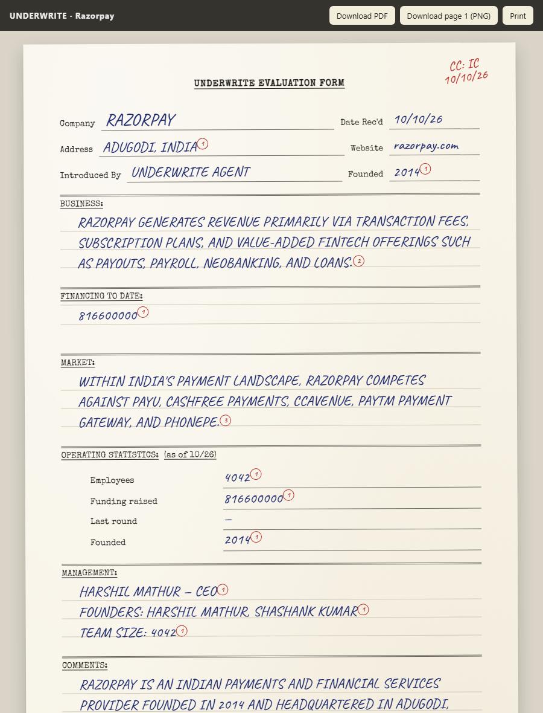
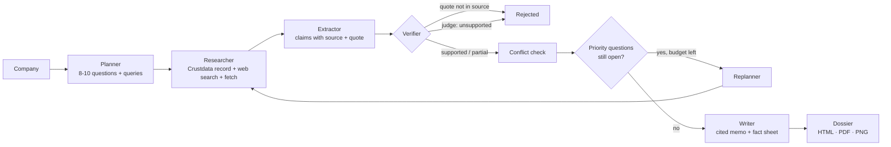
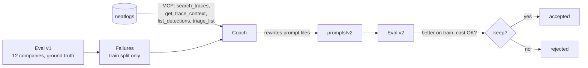

# Underwrite

**An autonomous due-diligence agent you can leave running overnight.**
Give it a list of startups. It researches each one, writes an investment memo where every fact links to the exact
sentence it came from, throws out anything its sources don't support, and flags where sources disagree. A Coach
agent reads Underwrite's own [neatlogs](https://neatlogs.com) traces, rewrites its prompts, and keeps a change only
if the eval score goes up.

**Live site (memo gallery + scoreboard):** https://hacker-git-code.github.io/underwrite-/
&nbsp;·&nbsp; Built for **#neatHack** (Oct 10–12, 2026), theme: *"Build agents you'd trust to run without you watching."*

<p align="center"></p>

Each memo is a three-page dossier modelled on Sequoia's famous 1977 evaluation form for Apple:
**page 1** an evaluation form (typed labels, hand-written answers, red circled source numbers, a VERIFIED stamp,
conflicts noted in the margin), **page 2** a typed memorandum with the full analysis, **page 3** an appendix with every
source, the claims it supports, the claims that were rejected, and the agent's run log. Download as PDF, or page 1 as PNG.

---

## Contents

- [What it does](#what-it-does)
- [Why you can trust it unattended](#why-you-can-trust-it-unattended)
- [How it works](#how-it-works)
- [Self-improvement: the Coach and neatlogs](#self-improvement-the-coach-and-neatlogs)
- [Results](#results)
- [Sponsor tools and how each is used](#sponsor-tools-and-how-each-is-used)
- [Quickstart](#quickstart)
- [Commands](#commands)
- [Configuration](#configuration)
- [Running it unattended on AWS](#running-it-unattended-on-aws)
- [Project layout](#project-layout)
- [Evidence checklist for judges](#evidence-checklist-for-judges)
- [Security and privacy](#security-and-privacy)
- [Limitations and roadmap](#limitations-and-roadmap)

## What it does

```
$ underwrite run "Razorpay" --domain razorpay.com

[plan    ] 9 questions, 18 queries for Razorpay
[crust   ] company record: 52 fields
[web     ] search (crustdata-web) 'Razorpay founding year headquarters location' -> 9 results
...
[crust   ] fetched 2/8 pages via Crustdata
[recover ] 6 pages empty via Crustdata; retrying them directly
[extract ] 8 claims from 33 evidence blocks
[verify  ] grounding: 8/8 quotes found in their cited source
[verify  ] judge: 7 supported, 1 partial, 0 rejected of 8
[plan    ] 4 priority questions unanswered -> research round 2
...
[memo    ] done in 302s · 12 claims · 92% supported · 0 conflicts · $0.013 LLM · 18 Crustdata credits · 3 recoveries
```

A first-pass diligence memo takes an analyst hours. Underwrite produces one in about 3–5 minutes for roughly
18 Crustdata credits and about a cent of LLM tokens at list price, and it can work through a whole watchlist overnight.

## Why you can trust it unattended

| Risk when nobody is watching | What Underwrite does |
|---|---|
| The model invents a fact | Every claim must carry a quote from one evidence block. Code checks that the quote is really in that source (fuzzy match ≥ 90%); claims that fail are rejected **without** asking a model. |
| The quote exists but doesn't prove the claim | A separate judge prompt sees only the claim, the quote, and the source text around it, and rules supported / partial / unsupported. Only supported and partial claims reach the memo. |
| Sources disagree | Verified values are clustered per fact (founding year, headcount, funding, HQ, CEO); more than one cluster is a **conflict**, written in red in the memo's margin (e.g. *"Crustdata says 18 employees, the website says 50"*). |
| The memo cites something unverified | Citations to claims that didn't pass verification are stripped before rendering, and counted. |
| An API fails (429, 5xx, timeout, empty page) | Exponential backoff with jitter, honouring `Retry-After`; Crustdata search → DuckDuckGo fallback; Crustdata fetch → direct fetch fallback. |
| A model is down, overloaded, or out of quota | Each role has a chain of models across providers (Gemini → Gemini → Groq → Cerebras → Claude on Bedrock). Dead models are skipped for the rest of the run; overloaded ones cool down for 2 minutes. |
| The model returns broken JSON | A cheap repair call fixes it against the JSON Schema instead of failing the run. |
| The machine crashes mid-run | State is checkpointed after every phase; `underwrite resume <run_id>` continues where it stopped. |
| Questions go unanswered | A replanner writes new queries for unanswered priority questions and runs a second research round, with 2 searches reserved for it. |
| It burns through credits | Per-company search/fetch budgets, a per-run credit cap, and a live balance floor (free `/account/credits` check). |
| You want to see it fail on purpose | `--chaos 0.3` injects labelled faults (429s, timeouts, malformed JSON) so the recovery paths can be demoed. |

## How it works



Every step is a neatlogs span (`WORKFLOW` → `AGENT` → `TOOL` / `GUARDRAIL` / LLM), every prompt is tracked with
its template and version, and every recovery is logged both to `events.jsonl` and as a neatlogs log span inside the trace.

The roles use different models on purpose: a "smart" model plans and writes (few calls), a cheaper "fast" model
extracts and judges (many calls), and the judge never sees the extractor's reasoning, only the claim and the source.

## Self-improvement: the Coach and neatlogs



1. **Measure.** `underwrite eval` runs a prompt version over 12 companies with hand-checked facts (founding year, HQ,
   founders, CEO) in `evals/dataset.json`, split 8 train / 4 test. It scores the memo's fact sheet against ground
   truth and records the agent's own trust metrics (grounding, support, coverage, conflicts, cost).
2. **Diagnose.** `underwrite coach` collects the train-split failures (wrong facts, rejected claims, unanswered
   questions, recovery events) and connects to the **neatlogs MCP server** to read what neatlogs saw: the span tree of
   the worst traces (`get_trace_context`), keyword/semantic trace search (`search_traces`), detections
   (`list_detections`) and suggested fixes (`triage_list`, `triage_get`).
3. **Change.** The smart model, at high reasoning effort, proposes targeted edits to the prompt files, each tied to
   the evidence behind it. Edits that drop a `{{placeholder}}` or the system/user separator are rejected automatically.
   It is told never to add company-specific facts, which would overfit the eval.
4. **Verify.** The new version is evaluated on the same companies (tool results are cached, so both versions see the
   same evidence), and it is **kept only if quality on the train split improves without cost rising more than 50%**.
   The test split is reported as the honest, held-out number. Every decision is written to
   `prompts/vN/COACH_NOTES.md`.

## Results

The live numbers are on the [scoreboard](https://hacker-git-code.github.io/underwrite-/#scoreboard) and in
`runs/eval-*/eval.json`. The v1 → v2 comparison from the Coach is in `prompts/v2/COACH_NOTES.md`.

<!-- RESULTS:START -->
_Evaluation in progress: this table is filled in from `runs/eval-*/eval.json` once the v1 baseline and the Coach's
v2 have both been scored._
<!-- RESULTS:END -->

## Sponsor tools and how each is used

| Tool | Used for | Where |
|---|---|---|
| **neatlogs** | Tracing every run (spans, prompt templates + versions, token cost, recovery log spans, sessions per batch); the **Coach reads traces, detections and triage fixes over the neatlogs MCP server** to decide how to improve the agent. | `underwrite/obs.py`, `underwrite/llm.py`, `underwrite/coach.py` |
| **Entire** | Every coding-agent session that built this repo is checkpointed and linked to its commit (`Entire-Checkpoint:` trailers, refs under `refs/entire/checkpoints/`), with secrets redacted. Run `entire checkpoint list` / `entire checkpoint explain <id>`. | git history, `.entire/` |
| **cfo.ai** | Business plan: pricing, unit costs measured from real runs, revenue scenarios, runway. | `business/PLAN.md` |
| **Crustdata** | Company records (founding, HQ, headcount + growth, funding rounds, investors, founders), live web search, and live page fetch. | `underwrite/tools/crustdata.py` |
| **AWS** | An EC2 t3.small runs the agent every night and publishes new memos to the site. | `deploy/` |
| **Gemini / Groq** (free tiers) | The LLMs, in fallback chains. Claude on Amazon Bedrock is supported as a provider too. | `underwrite/llm.py` |

## Quickstart

Requirements: Python 3.10–3.13 and [uv](https://docs.astral.sh/uv/).

```bash
git clone https://github.com/hacker-git-code/underwrite-.git underwrite && cd underwrite
uv sync
cp .env.example .env        # then paste your keys (see below)
uv run underwrite doctor    # checks every key, model and the neatlogs MCP connection
uv run underwrite run "Linear" --domain linear.app --open
```

Keys (all have free tiers):

| Variable | Where to get it |
|---|---|
| `GEMINI_API_KEY` | https://aistudio.google.com/apikey |
| `GROQ_API_KEY` | https://console.groq.com/keys |
| `CRUSTDATA_API_KEY` | Crustdata dashboard |
| `NEATLOGS_API_KEY` | https://app.neatlogs.com → project → API key |
| `CEREBRAS_API_KEY`, `AWS_BEARER_TOKEN_BEDROCK` | optional extra fallbacks |

## Commands

| Command | What it does |
|---|---|
| `underwrite run "Company" --domain x.com [--open] [--chaos 0.3]` | Research one company and write its dossier |
| `underwrite batch watchlist.txt [--new-only] [--limit N]` | Research a list unattended (`Company, domain` per line) |
| `underwrite resume <run_id>` | Continue an interrupted run from each company's last saved phase |
| `underwrite eval --prompts v1 [--split train\|test\|all]` | Score a prompt version against ground truth |
| `underwrite coach --base v1` | Improve the prompts from neatlogs traces + eval failures, evaluate, keep or reject |
| `underwrite compare v1 v2 [--split test]` | Before/after table between two evals |
| `underwrite render <run_id> [--open]` | Re-draw dossiers (HTML + PDF) without re-running the agent |
| `underwrite site [--open]` | Build the website in `docs/` (merges with what's already published) |
| `underwrite doctor` | Check keys, models, Crustdata balance and the neatlogs MCP connection |

## Configuration

All optional, set in `.env`:

| Variable | Default | Meaning |
|---|---|---|
| `UW_MODELS_SMART` | `gemini:gemini-3.8-flash,gemini:gemini-3.5-flash,groq:openai/gpt-oss-120b,…` | Planner/writer/coach model chain |
| `UW_MODELS_FAST` | `gemini:gemini-3.5-flash-lite,gemini:gemini-3.1-flash-lite,groq:openai/gpt-oss-20b,…` | Extractor/judge model chain |
| `UW_PROMPTS` | `v1` | Prompt version to run |
| `UW_MAX_SEARCHES` / `UW_RESERVE_SEARCHES` | `10` / `2` | Web searches per company, and how many are held for the gap round |
| `UW_MAX_FETCHES` / `UW_PAGE_CHARS` | `8` / `4000` | Pages fetched per company, characters kept per page |
| `UW_MAX_ROUNDS` | `2` | Research rounds per company |
| `UW_MAX_CREDITS_PER_RUN` | `400` | Stop a batch after this many Crustdata credits |
| `UW_MIN_CREDIT_BALANCE` | `100` | Don't start a company if the live balance is below this |
| `UW_CHAOS` | `0` | Fault-injection rate for recovery demos |

Models are written `provider:model`; providers are `gemini`, `groq`, `cerebras`, `openrouter` (OpenAI-compatible)
and `bedrock` (Claude via the Anthropic SDK's Bedrock Mantle client).

## Running it unattended on AWS

`deploy/` holds a one-command setup for an Ubuntu EC2 instance (t3.small) that runs `deploy/nightly.sh` every night
at 02:00 IST: it researches the next 3 companies on `deploy/watchlist.txt`, rebuilds the site, and pushes with a
repo-scoped deploy key. Step-by-step guide: [deploy/README.md](deploy/README.md).

## Project layout

```
underwrite/
  cli.py            commands
  pipeline.py       resumable per-company state machine, batch runner, credit guards
  agents/           planner, researcher, extractor, verifier, writer
  tools/            crustdata.py (enrich, web search, fetch, balance), web.py (keyless fallbacks, SSRF guard)
  llm.py            provider chains, retries, cooldowns, JSON repair, prompt tracking
  obs.py            neatlogs setup, event log, trace ids
  resilience.py     retry/backoff, rate limiting, chaos injection
  evals.py          scoring against ground truth, compare
  coach.py          neatlogs MCP client + prompt rewriting + eval gate
  report.py         the three-page paper dossier (HTML, PDF, PNG)
  site.py           static site for GitHub Pages
prompts/vN/         versioned prompt files (the Coach writes new versions + COACH_NOTES.md)
evals/dataset.json  12 companies with hand-checked facts, train/test split
runs/               per-run memos, event logs and eval results
docs/               the published website
deploy/             EC2 setup + nightly job
business/           business plan for cfo.ai
tests/              offline end-to-end tests (fake LLM + fake tools)
```

## Evidence checklist for judges

- [ ] **Before/after with numbers**: [Results](#results), `prompts/v2/COACH_NOTES.md`, `underwrite compare v1 v2`
- [x] **neatlogs traces**: every run is a trace in the project; ids are printed by each run and in each dossier's appendix
- [x] **Entire checkpoints**: `Entire-Checkpoint:` trailers on commits; `entire checkpoint list` in a clone
- [ ] **cfo.ai business plan**: `business/PLAN.md` + cfo.ai model
- [x] **A failure the agent recovered from**: see the `[recover]` lines in any run's `events.jsonl`, and the chaos run
- [ ] **Public posts tagged #neatHack**: linked from `hackathon.md`
- [x] **Public repo with commits dated during the hackathon**: this repository

## Security and privacy

- API keys live only in `.env` (git-ignored). The repo history, every tracked file and every Entire checkpoint were
  scanned for the real key values: none present. Entire also redacts secrets from checkpoint transcripts.
- Web content is untrusted: prompts tell the models to ignore instructions found in evidence; the dossier escapes
  all model and web text and renders only `http(s)` links (tested).
- The direct page fetcher refuses any URL (including after redirects) that resolves to a non-public address, so it
  can't be pointed at the cloud metadata service (tested).
- Raw page text (`state.json`) and PDFs stay out of git; only memos, event logs and eval summaries are published.
- The EC2 runner has no IAM role, SSH from one IP only, `chmod 600 .env`, and a deploy key scoped to this repo.

## Limitations and roadmap

- Ground truth covers stable facts only (founding year, HQ, founders, CEO); judgement quality (market, risks) is not
  scored automatically yet.
- Free-tier LLMs have daily quotas; large batches need a paid key or Claude on Bedrock (supported).
- Next: a reviewer UI for accepting/overriding claims, watchlist alerts when a company's facts change
  (Crustdata Watcher), and Coach-created neatlogs detections (`create_detection`) for new failure modes.

## License

MIT, see [LICENSE](LICENSE).
